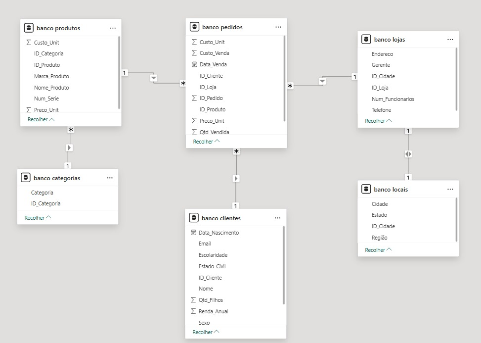
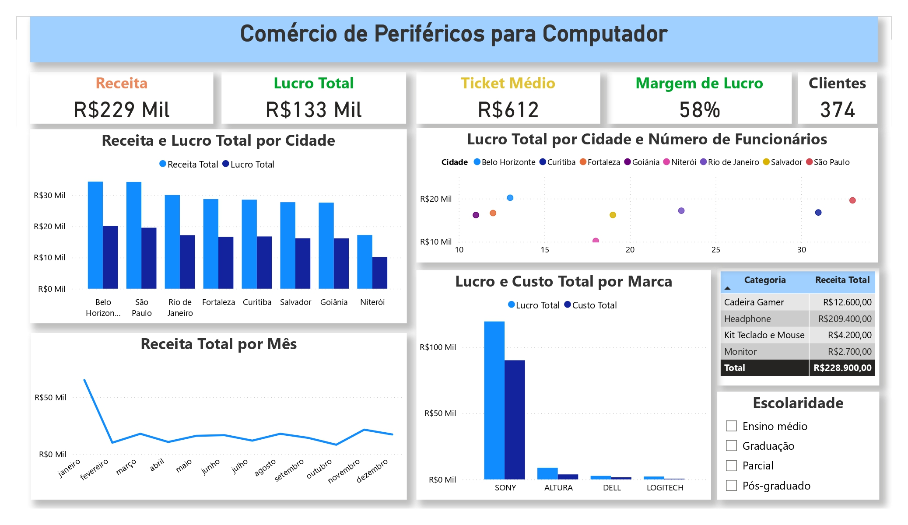

# E-commerce Sales Analytics


An end-to-end analytics portfolio project for a fictional computer-peripherals retailer. It combines a relational MySQL dataset, business-focused SQL analysis, and an interactive Power BI dashboard to turn sales data into actionable insights.

## Project goals

- Model a realistic retail operation with customers, products, categories, stores, locations, and orders.
- Explore sales performance, customer behavior, profitability, and product mix with reusable SQL queries.
- Present executive-level KPIs and trends in a Power BI dashboard.
- Demonstrate practical data analytics skills: relational modeling, exploratory analysis, KPI design, and data storytelling.

## Repository structure

```text
.
├── Database/
│   ├── customers.sql
│   ├── categories.sql
│   ├── locations.sql
│   ├── stores.sql
│   ├── orders.sql
│   └── products.sql
├── MySQL-KPIs/
│   ├── 01-exploratory-analysis.sql
│   ├── 02-relational-analysis.sql
│   ├── 03-margin-and-profitability.sql
│   └── 04-customer-and-product-kpis.sql
└── PowerBI-Dashboard/
    ├── ecommerce-sales-dashboard.pbix
    ├── dashboard-preview.jpg
    └── relational-model.jpg
```

> The SQL table and column names remain in their original Portuguese form because they are part of the existing data model referenced by the Power BI report. Documentation, folder names, query comments, and query output aliases are in English.

## Data model

The model contains six core entities:

| Entity | Purpose |
| --- | --- |
| `clientes` | Customer demographics and socioeconomic attributes |
| `pedidos` | Order-level sales, revenue, cost, and quantity data |
| `produtos` | Product catalog and product attributes |
| `categorias` | Product category hierarchy |
| `lojas` | Physical store and manager information |
| `locais` | Geographic information for stores |

Relationships:

- `clientes` 1:N `pedidos`
- `produtos` 1:N `pedidos`
- `lojas` 1:N `pedidos`
- `categorias` 1:N `produtos`
- `lojas` 1:1 `locais`



## Analysis workflow

1. Import the SQL files in `Database/` into a MySQL database.
2. Run the scripts in `MySQL-KPIs/` in order:
   - **Exploratory analysis:** dataset dimensions, customer distribution, and product pricing.
   - **Relational analysis:** store, category, product, and customer performance.
   - **Margin and profitability:** revenue, profit, and margin by product, category, and store.
   - **Customer and product KPIs:** revenue by income segment and repeat-order behavior.
3. Open `PowerBI-Dashboard/ecommerce-sales-dashboard.pbix`.
4. Update the MySQL connection if needed and refresh the report.

## Dashboard highlights

The report focuses on:

- Total revenue and profit
- Average order value
- Profit margin
- Customer count
- Revenue and profit by store and city
- Revenue trends over time
- Cost and profit by brand
- Revenue by product category
- Customer segmentation by education level



## Tools

- **MySQL** for relational storage and analytical queries
- **Power BI** for data modeling, DAX measures, and visualization
- **SQL** for exploratory analysis and business KPI development

## Portfolio takeaways

This project demonstrates the complete path from raw relational data to a decision-ready dashboard. It is intentionally structured so that each analytical question can be traced back to the source tables and reproduced in MySQL.
